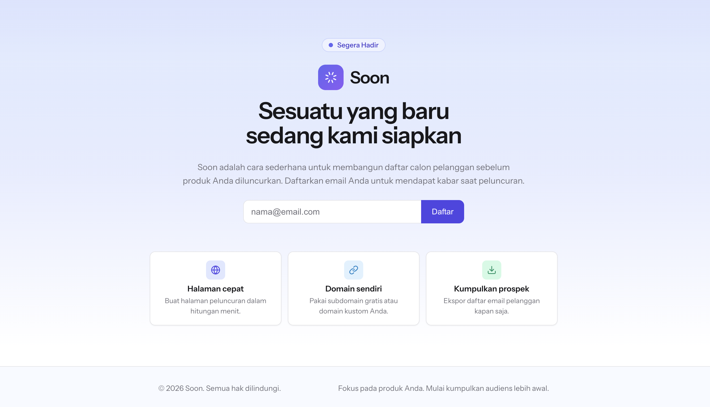

# Soon — Coming-Soon Page + Waitlist

A self-contained [Cloudflare Worker](https://workers.cloudflare.com/) that serves a coming-soon page and collects subscribers with a **double opt-in**
flow. Signups are emailed a confirmation link, and only once it is clicked is the
address stored as a contact in [Resend](https://resend.com). Confirmation links are
**stateless signed tokens**, so there is no database to run.

> **Want it done for you?** [**soon.my.id**](https://soon.my.id) is a hassle-free coming-soon
> page generator. **Start free** with **1 page**,
> **500 subscribers**, and a **subdomain** — no setup, no database, no code.
> 👉 [Create your page on soon.my.id](https://soon.my.id)



## Features

- Coming-soon landing page with an email signup form.
- Double opt-in: no contact is stored until the confirmation link is clicked.
- Stateless signed tokens (24h confirm / 1-year unsubscribe) — no database.
- Resend Contacts as the subscriber store, with Segment support for broadcasts.
- Optional per-IP rate limiting via Cloudflare's native rate limiter.
- Baseline security headers and a Content-Security-Policy.

## Quick start

Requires Node 22+, a Cloudflare account, and a Resend account with a verified
sending domain.

```bash
npm install

cp wrangler.toml.example wrangler.toml   # wrangler.toml is git-ignored
cp .dev.vars.example .dev.vars           # local vars/secrets for `wrangler dev`
# fill in RESEND_API_KEY (Full access), EMAIL_FROM and TOKEN_SECRET

npm run dev                              # http://localhost:8787
```

Open <http://localhost:8787>, submit an email, then click the confirmation link
from the sent email.

## Configuration

Copy the committed template and fill in the placeholders:

```bash
cp wrangler.toml.example wrangler.toml
```

| Key | Purpose |
| --- | --- |
| `[assets] directory` | Static assets (`./public`) served before the Worker runs. |
| `[[ratelimits]] SUBSCRIBE_RATE_LIMITER` | Native rate limit for `POST /subscribe` (per IP). Optional. |
| `[[routes]]` | Optional: bind to your zone instead of `*.workers.dev`. |
| `[vars] RESEND_SEGMENT_ID` | Segment confirmed contacts are added to. |
| `[vars] PUBLIC_BASE_URL` | Absolute base for confirmation links; defaults to the request origin. |

### Secrets & vars

| Name | Where | Purpose |
| --- | --- | --- |
| `RESEND_API_KEY` | secret | Resend key for Contacts **and** sending. Must be **Full access** — a *Sending access* key fails Contacts with `401 restricted_api_key`. |
| `EMAIL_FROM` | secret | Verified sender, e.g. `Soon <hello@soon.example.com>`. |
| `TOKEN_SECRET` | secret | HMAC key for confirmation/unsubscribe tokens (`openssl rand -base64 32`). |
| `RESEND_SEGMENT_ID` | var (optional) | Segment confirmed contacts are added to. |
| `PUBLIC_BASE_URL` | var (optional) | Absolute base URL for confirmation/unsubscribe links. |

Local `wrangler dev` reads them from `.dev.vars`. For production:

```bash
npx wrangler secret put RESEND_API_KEY
npx wrangler secret put EMAIL_FROM
npx wrangler secret put TOKEN_SECRET
```

## How it works

1. `POST /subscribe` — validates the email (format + honeypot + 2s time-trap) and
   emails a confirmation link. Nothing is stored yet.
2. `GET /confirm?token=…` — creates the contact (or re-activates it) and adds it to
   the Segment. Tampered or expired links are rejected (24h TTL).
3. `GET /unsubscribe?token=…` — sets `unsubscribed: true` (1-year TTL).
4. `GET /health` — `{ ok: true }`.

The `/subscribe` response is intentionally uniform so a duplicate address is never
revealed.

## Project layout

- `src/index.ts` — fetch handler and routes.
- `src/subscribe.ts` — submission validation (email, honeypot, time-trap).
- `src/tokens.ts` — stateless HMAC-signed tokens.
- `src/audience.ts` — Resend Contacts client.
- `src/email.ts` — `EmailSender` interface + Resend implementation.
- `src/render.ts` — landing and status page rendering.
- `src/rate-limit.ts` — optional Cloudflare rate limiter.
- `src/templates/` — landing, status, and confirmation-email HTML.
- `public/assets/landing.css` — stylesheet served from Workers Assets.
- `test/` — Vitest specs with in-memory `FakeResend`/`FakeRateLimit`.

## Commands

```bash
npm run dev         # wrangler dev (http://localhost:8787)
npm test            # vitest run
npm run typecheck   # tsc --noEmit
npm run deploy      # wrangler deploy
```

## Deploy

```bash
npx wrangler login                              # or set CLOUDFLARE_API_TOKEN + ACCOUNT_ID
npx wrangler secret put RESEND_API_KEY          # Full access key
npx wrangler secret put EMAIL_FROM
npx wrangler secret put TOKEN_SECRET
npm run deploy
```

`wrangler deploy` prints the deployed URL. To use a custom domain, add a `[[routes]]`
block in `wrangler.toml` and set `PUBLIC_BASE_URL` to that domain.

## License

[MIT](./LICENSE)

---

Built and maintained by the team behind [**soon.my.id**](https://soon.my.id) —
a free coming-soon page generator (1 page, 500 subscribers, subdomain included).
